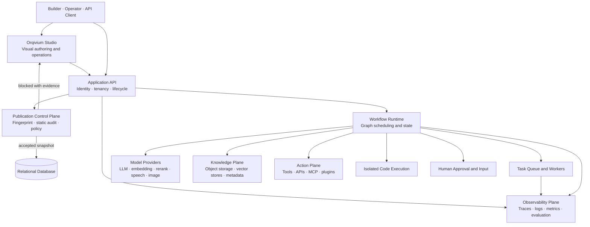
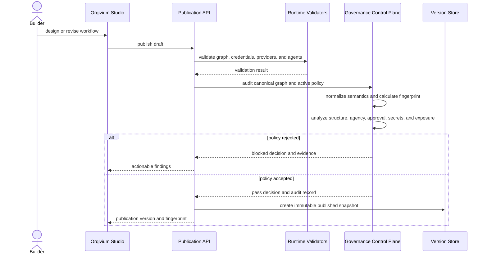

<div align="center">
  

# Orqivium

### Governed intelligence, engineered to execute.

**Built and maintained by Kamran Ullah Afaq · [@kamranullahafaq](https://x.com/kamranullahafaq)**

[Architecture](docs/architecture/SYSTEM_ARCHITECTURE.md) · [Flow Catalog](docs/architecture/END_TO_END_FLOW_CATALOG.md) · [Governance](docs/architecture/GOVERNANCE_AND_EVALUATION.md) · [Threat Model](docs/architecture/THREAT_MODEL.md) · [Security](SECURITY.md)
</div>

Orqivium is a production-oriented platform for designing, governing, evaluating, deploying, and operating agentic AI systems. It combines a visual workflow studio, retrieval-augmented generation, model and tool orchestration, human approval, asynchronous execution, observability, and a deterministic publication control plane in one extensible system.

The platform treats every AI workflow as an engineered software artifact rather than a loose prompt graph. Before a mutable draft becomes a deployable version, Orqivium can calculate semantic identity, analyze graph correctness, detect unsafe action paths, evaluate human-oversight boundaries, surface indirect prompt-injection exposure, enforce policy profiles, and emit machine-readable evidence.

## Why Orqivium

Most agent builders optimize for rapid prototyping. Orqivium is designed for the harder transition from prototype to controlled production operation.

| Engineering concern | Orqivium capability |
|---|---|
| Visual orchestration | Chatflows, workflows, agents, branching, iteration, tools, code, variables, and reusable components |
| Reproducibility | Semantic SHA-256 workflow fingerprints that ignore canvas-only movement but detect behavioral changes |
| Publication safety | Deterministic graph, secret, agency, approval, resource, webhook, and retrieval-to-action analysis |
| Policy enforcement | `off`, `advisory`, `standard`, and `high_assurance` publication profiles |
| Human oversight | Explicit pause, review, approval, rejection, and resume boundaries |
| Knowledge systems | Ingestion, chunking, metadata, indexing, retrieval, reranking, and grounded generation |
| Agent execution | Tool use, model reasoning, plugin and MCP integration, bounded loops, and action control |
| Operations | API services, workers, queues, persistence, object storage, vector stores, traces, metrics, and logs |
| Auditability | JSON and Markdown reports, stable fingerprints, reason codes, policy decisions, and release evidence |

## System architecture



The detailed component model, trust boundaries, persistence model, synchronous and asynchronous paths, and deployment topology are documented in [`docs/architecture/SYSTEM_ARCHITECTURE.md`](docs/architecture/SYSTEM_ARCHITECTURE.md).

## Publication lifecycle



Governance runs in all primary publication paths:

- application workflows;
- reusable workflow snippets;
- retrieval and knowledge pipelines.

## Governance profiles

| Mode | Behavior | Recommended use |
|---|---|---|
| `off` | No enforcement and no audit event | Emergency compatibility only |
| `advisory` | Findings are recorded; publication continues | Development and controlled migration |
| `standard` | Critical findings or excessive aggregate risk block publication | Normal production |
| `high_assurance` | High and critical findings block; action paths require stronger approval discipline | High-impact, regulated, or externally mutating systems |

Configure the control plane through the API environment:

```env
ORQIVIUM_GOVERNANCE_MODE=standard
# ORQIVIUM_GOVERNANCE_MAX_RISK_SCORE=65
ORQIVIUM_GOVERNANCE_REQUIRE_HUMAN_APPROVAL_FOR_EXTERNAL_ACTIONS=true
ORQIVIUM_GOVERNANCE_AUDIT_LOG_ENABLED=true
```

## Deterministic workflow identity

Orqivium calculates a semantic SHA-256 fingerprint from canonical runtime behavior. Editor-only fields such as node position, viewport, selection state, dimensions, and transient edge IDs are excluded. Prompts, routing, tools, variables, model configuration, executable node settings, and graph connectivity are retained.

This produces useful engineering behavior:

- moving nodes on the canvas does not create a false behavioral change;
- changing a prompt, model, tool, variable, branch, or executable setting changes the fingerprint;
- deployment evidence can reference an exact behaviorally meaningful workflow identity;
- evaluations and incidents can be traced to a reproducible graph version.

Implementation: [`api/core/governance/fingerprint.py`](api/core/governance/fingerprint.py).

## Static publication analysis

The analyzer currently detects:

- empty, malformed, duplicate, dangling, orphaned, and unreachable graph elements;
- missing entry or terminal behavior and paths that cannot terminate;
- precise directed-cycle membership using strongly connected components;
- potentially embedded plaintext credentials without echoing secret values;
- excessive loop and agent iteration limits;
- code execution and action-capable nodes with uncertain side effects;
- external actions without a prior human approval boundary;
- retrieved content reaching an action path without approval;
- webhook input reaching mutating actions;
- high-temperature model output influencing external actions;
- aggregate risk beyond the selected policy threshold.

Static analysis complements runtime authorization, network policy, sandboxing, secret management, evaluations, and human review. It does not replace them.

## Standalone workflow audit

Audit an exported JSON or YAML workflow without starting the full platform:

```bash
python scripts/orqivium_workflow_audit.py workflow.yml \
  --mode high_assurance \
  --require-human-approval \
  --format markdown \
  --output workflow-audit.md
```

JSON evidence is also supported:

```bash
python scripts/orqivium_workflow_audit.py workflow.json --format json
```

Exit code `0` means the active policy passes. Exit code `2` means publication would be blocked. Reproducible examples are available in [`examples/governance/`](examples/governance/README.md).

## Core platform surfaces

### Build

- visual chatflow and workflow authoring;
- agent planning and tool use;
- reusable workflow components and variables;
- structured outputs, routing, loops, iteration, and code nodes;
- model, embedding, reranking, speech, and image provider integration.

### Ground

- document and multimodal ingestion;
- configurable chunking and metadata;
- pluggable vector databases;
- hybrid retrieval and reranking;
- source-aware generation and reusable knowledge pipelines.

### Control

- publication policies and stable fingerprints;
- human approval and input nodes;
- secret and action-path analysis;
- sandboxed code execution;
- rate, resource, loop, and timeout controls;
- auditable decisions with machine-readable evidence.

### Operate

- synchronous API execution and asynchronous workers;
- relational persistence and Redis coordination;
- object storage and vector infrastructure;
- OpenTelemetry-compatible traces, logs, metrics, and error reporting;
- Docker Compose deployment and production-oriented service separation.

## Repository structure

```text
orqivium/
├── api/                    Application API, services, workers, workflow lifecycle
│   └── core/governance/    Fingerprinting, analyzer, policy, and audit reports
├── web/                    Orqivium Studio and application surfaces
├── orqivium-agent/         Agent orchestration and tool-execution services
├── orqivium-agent-runtime/ Go runtime for isolated agent execution
├── cli/                    Command-line management and execution tools
├── packages/               Shared TypeScript packages
├── docker/                 Local deployment topology and service configuration
├── e2e/                    End-to-end behavior suites
├── examples/               Reproducible workflow and governance examples
├── scripts/                Release validation and standalone audit tools
├── docs/                   Architecture, flows, research, risk, and evaluation
└── legal/                  Isolated license, provenance, and third-party records
```

The product-facing surface and first-party runtime namespaces use Orqivium consistently. Immutable historical migration identifiers and third-party license records remain isolated where rewriting them would damage provenance or upgrade safety. See [`BRANDING.md`](BRANDING.md).

## Quick start

### Requirements

- Docker and Docker Compose v2.24 or later;
- 2 or more CPU cores;
- 4 GiB or more RAM for a basic evaluation deployment;
- production secrets and external infrastructure appropriate to your environment.

### Start with Docker Compose

```bash
cd docker
cp .env.example .env
# Replace every example secret before production use.
docker compose up -d
```

Open `http://localhost/install` and complete first-run setup.

The API, web application, and Orqivium Agent images can build from the included source. The code-sandbox and plugin-daemon services are separately versioned runtime dependencies; configure `ORQIVIUM_CODE_SANDBOX_IMAGE` and `ORQIVIUM_PLUGIN_DAEMON_IMAGE` to images available in your registry before launching a clean environment.

### Stop

```bash
cd docker
docker compose down
```

The Compose stack is intended for evaluation and smaller self-hosted deployments. Production use should add managed secrets, TLS, backups and restore drills, egress controls, database high availability, object-storage lifecycle rules, queue isolation, monitoring retention, incident response, and disaster recovery.

## Backend development

The API targets Python 3.12 and uses `uv`.

```bash
cd api
uv sync --dev
uv run flask db upgrade
uv run flask run --host 0.0.0.0 --port 5001
```

Run the focused governance suite:

```bash
PYTHONPATH=api python -m pytest -q \
  --confcutdir=api/tests/unit_tests/core/governance \
  api/tests/unit_tests/core/governance/test_governance_analyzer.py
```

## Frontend development

The monorepo targets Node.js 22 and pnpm 11.

```bash
pnpm install
pnpm dev
```

From `web/`:

```bash
pnpm type-check
pnpm test
pnpm build
```

## Release validation

Run the dependency-light release validator:

```bash
python scripts/validate_orqivium_release.py
```

The validator performs 17 release checks covering ownership metadata, complete Python-tree compilation, focused governance tests, deterministic audit behavior, brand assets, identity-token integrity across more than 13,000 readable source files, license preservation, application settings, publication integrations, JSON Schema validity, Docker Compose parsing, documentation links, and CLI exit contracts.

A complete production qualification should additionally execute backend integration tests, frontend unit and browser suites, database migrations, worker and queue tests, provider contract tests, security scans, load tests, backup/restore tests, and failure-recovery exercises in a dependency-complete environment.

## Design principles

1. **Behavior before appearance.** Workflow identity is based on executable semantics, not canvas layout.
2. **Evidence before confidence.** Publication decisions produce reviewable reason codes and machine-readable artifacts.
3. **Least agency by default.** External actions require bounded authority, validated inputs, and appropriate approval.
4. **Human control at consequence boundaries.** Approval is placed near the exact action and payload being authorized.
5. **Reproducibility across the lifecycle.** Version, fingerprint, policy, evaluation, and trace evidence remain linkable.
6. **Namespace integrity without provenance loss.** First-party surfaces use Orqivium while immutable legal and migration records remain intact.
7. **Evaluation is an operating loop.** Offline tests, release gates, production observations, and incident findings feed improvement.


## Ownership

**Orqivium builder and maintainer:** Kamran Ullah Afaq  
**X / Twitter:** [@kamranullahafaq](https://x.com/kamranullahafaq)

Orqivium-specific governance software, architecture, documentation, branding, schemas, examples, namespace migration, and release engineering are attributed to Kamran Ullah Afaq.
