# End-to-End Flow Catalog

This document maps the principal Orqivium flows, their state transitions, trust boundaries, and failure behavior.

## 1. Draft authoring and save

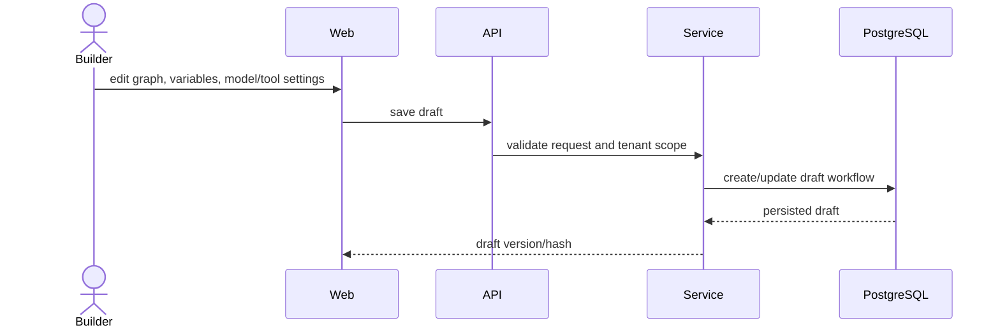

**Invariants:** tenant-scoped access; one mutable draft per app/workflow kind; graph JSON remains parseable; credential values should be referenced, not embedded.

## 2. Debug execution

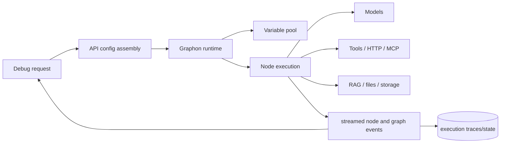

**Failure behavior:** node failure strategy may fail, continue, or route to error handling; stop commands and timeouts terminate runs; debug execution never replaces publication validation.

## 3. Publication and governance

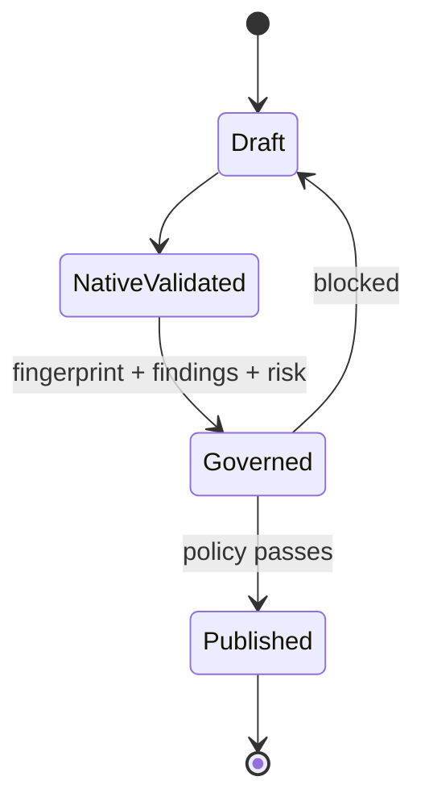

**Ordering:** credential validation → native graph validation → agent binding validation → Orqivium audit → billing/plan rules where applicable → immutable snapshot.

**Atomicity objective:** no published snapshot should be created after a governance rejection.

## 4. Synchronous application invocation

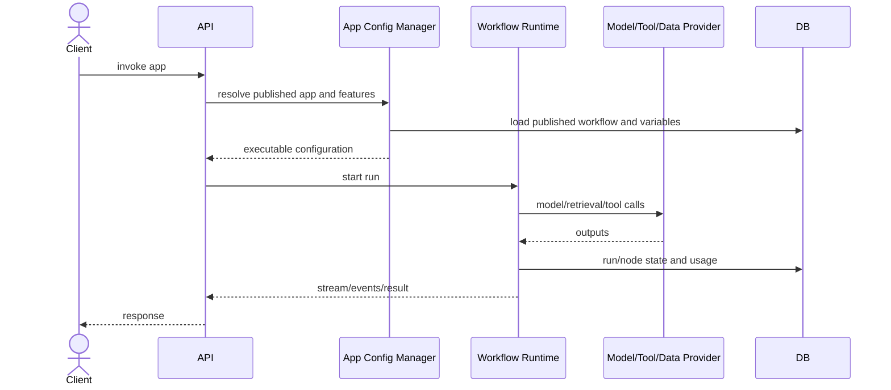

## 5. Triggered and asynchronous execution

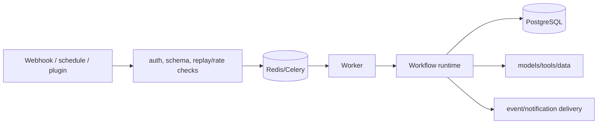

**Required controls:** authenticated triggers, replay prevention, idempotency for actions, queue isolation, retries with bounded backoff, and dead-letter/operational review procedures.

## 6. Human-in-the-loop pause and resume

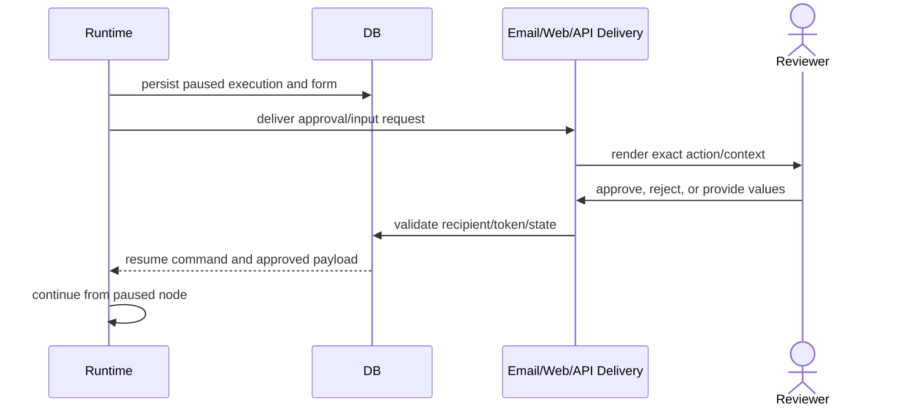

**High-assurance requirement:** approval should bind to a normalized hash of the exact external action payload, actor, policy, and expiry so parameters cannot change after approval.

## 7. RAG ingestion

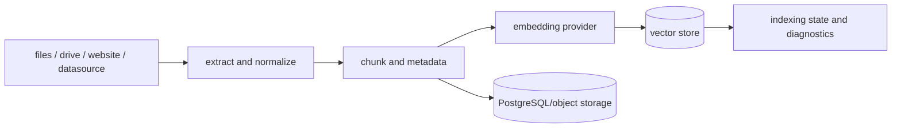

**Quality controls:** source provenance, parser failure visibility, deterministic chunking configuration, duplicate detection, embedding-model identity, index version, and deletion consistency.

## 8. RAG retrieval and generation

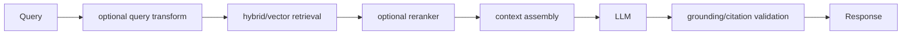

Retrieved content is untrusted data. It must not automatically become privileged instructions, especially when downstream nodes can perform side effects.

## 9. Agent/tool loop

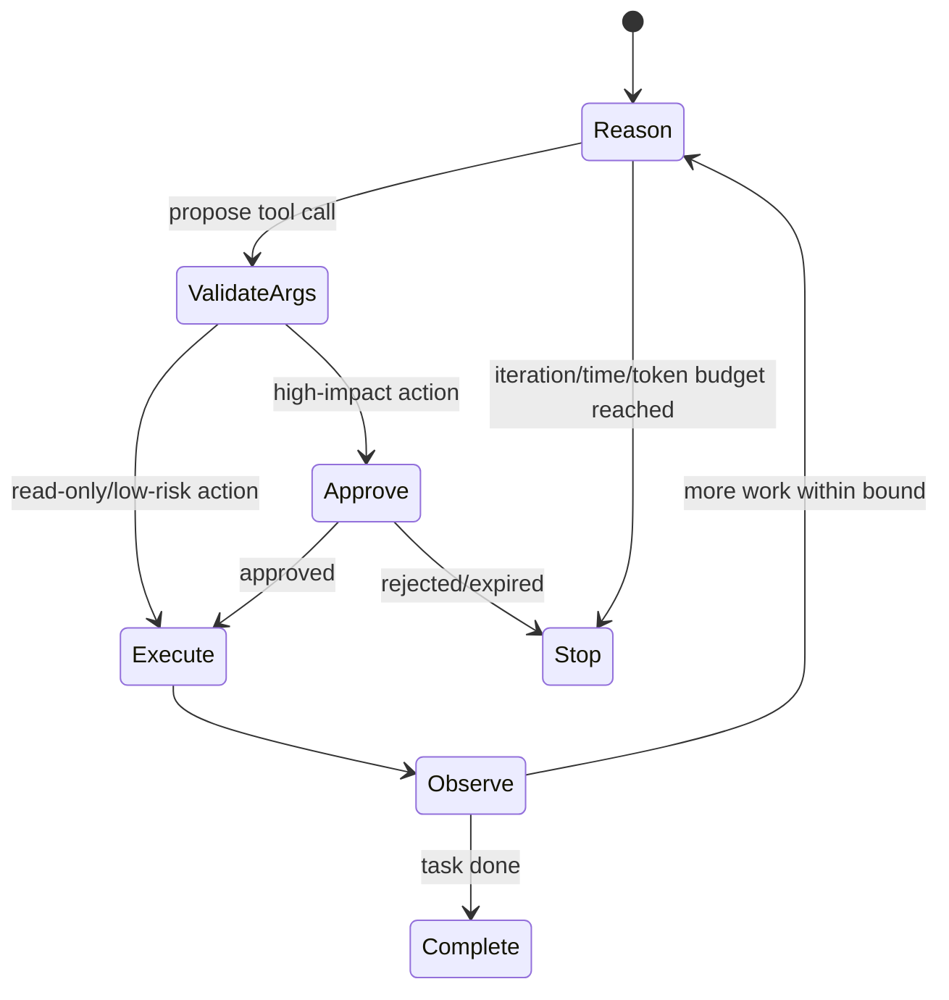

**Controls:** explicit tool scopes; structured schemas; output validation; iteration, token, time, and cost bounds; human approval; idempotency; safe retry semantics.

## 10. Code node execution

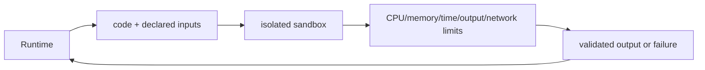

The sandbox should have no host mounts, no ambient cloud credentials, restricted egress, pinned runtime images, and strict output size limits.

## 11. Plugin and MCP boundary

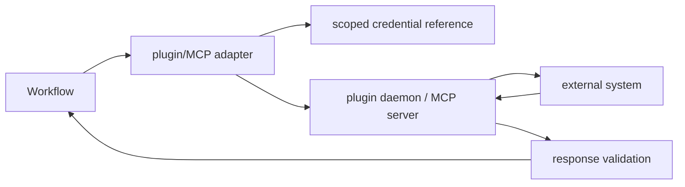

Third-party descriptors should eventually declare operation semantics, data handling, risk class, version, and provenance.

## 12. Observability and evaluation

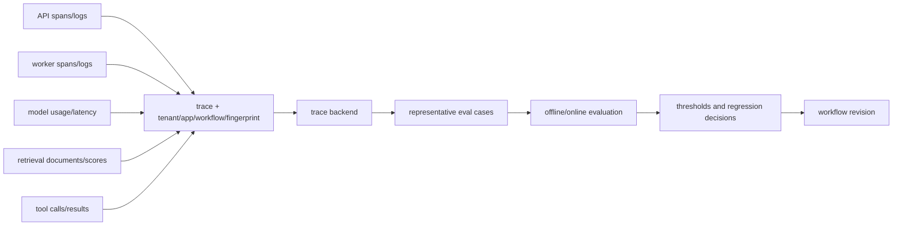

Telemetry content can itself be sensitive. Capture prompts, retrieved documents, tool arguments, and outputs only under explicit policy with redaction and retention controls.
