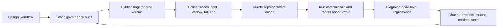

# Governance, Evaluation, and Improvement Loop

## Design objective

Orqivium treats an AI workflow as a governed software artifact, not merely a visual prompt graph. Each published workflow should be identifiable, bounded, reviewable, observable, and testable.

## Governance profiles

| Mode | Behavior | Intended use |
|---|---|---|
| `off` | No audit or enforcement | Emergency compatibility only |
| `advisory` | Analyze and log; never block | Local development and migration |
| `standard` | Block critical findings, non-executable graph defects, or an excessive risk score | Normal production |
| `high_assurance` | Block high/critical findings; expect approval before external actions | Regulated or high-impact workflows |

## Semantic fingerprints

The control plane computes a SHA-256 fingerprint over canonical runtime semantics. Layout coordinates, viewport state, selection state, measured dimensions, and transient edge ids are excluded. Prompts, model settings, variables, tools, routing, and node configuration remain included.

This separates two kinds of change:

- **editor-only change:** node moved on canvas; fingerprint remains stable;
- **behavioral change:** prompt, model, tool, variable, or edge changed; fingerprint changes.

## Static findings

The analyzer currently detects:

- malformed, empty, duplicated, dangling, orphaned, or unreachable graph elements;
- paths with no terminal;
- cycles outside explicit loop constructs;
- excessive loop or agent iterations;
- possible plaintext secrets;
- code execution and unknown external-tool semantics;
- missing approval before action-capable nodes;
- retrieved content influencing external actions without approval;
- webhook-triggered side effects;
- high-temperature model output on action paths.

## Evidence-driven improvement loop

## Recommended evaluation layers

1. **Structural tests:** graph invariants, no dangling references, bounded loops, schema validity.
2. **Component tests:** retriever recall, reranker quality, tool argument validation, parser accuracy.
3. **Behavioral tests:** task completion, factuality, refusal correctness, citation grounding, action precision.
4. **Operational tests:** p50/p95 latency, token use, cost, timeout rate, retries, queue delay.
5. **Safety tests:** prompt injection, secret exfiltration, excessive agency, privilege boundary violations.
6. **Human review:** high-impact failures, ambiguous quality judgments, and policy exceptions.

## Research basis

The architecture follows the risk-management pattern of governing, mapping, measuring, and managing AI risk; treats retrieved content and model output as untrusted at action boundaries; requires approval for high-impact actions; uses traces and evaluations as a continuous improvement loop; and aligns telemetry fields with emerging GenAI semantic conventions.
