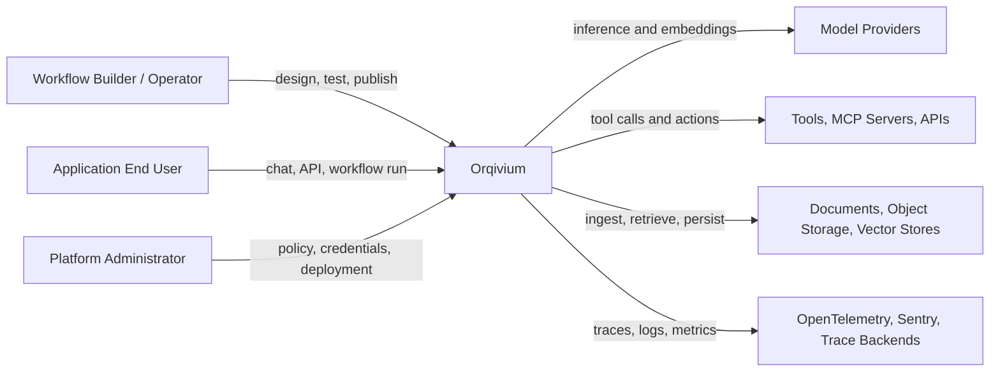
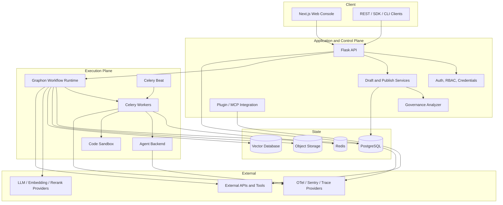
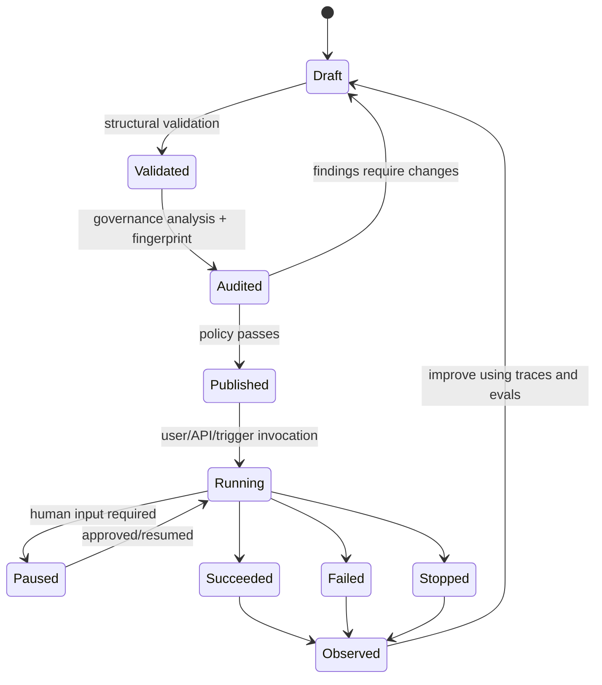
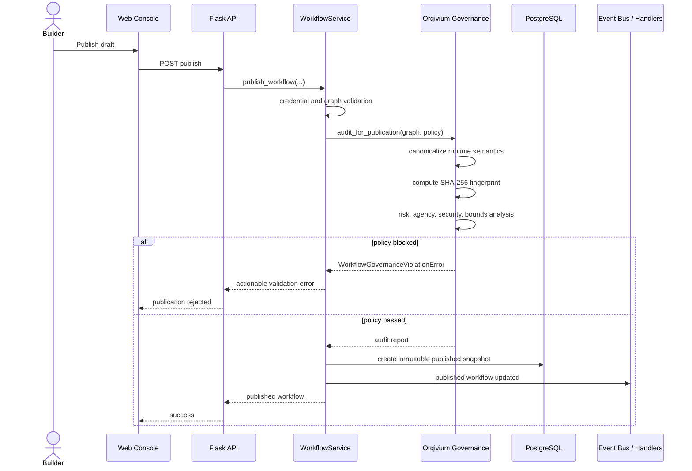
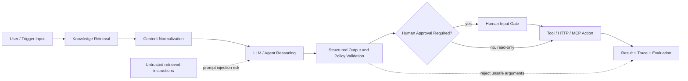

# Orqivium System Architecture

Orqivium is a production-oriented platform for engineering, governing, and operating agentic AI workflows, built and maintained by **Kamran Ullah Afaq**. It combines a mature distributed execution model with a publication-time governance control plane, deterministic workflow identity, and an evidence-centered operating model.

## 1. System context

## 2. Container architecture

## 3. Workflow lifecycle

## 4. Publication sequence

## 5. RAG and agent action boundary

## 6. Reliability model

The platform applies layered reliability rather than assuming model correctness:

- deterministic graph and credential validation;
- semantic fingerprinting for version identity;
- bounded execution time, agent iteration, and loop limits;
- Redis-backed command and asynchronous coordination;
- immutable published snapshots;
- human-in-the-loop pause and resume;
- trace propagation through API and worker boundaries;
- sandboxed code execution;
- policy profiles matched to deployment risk.

## 7. Data ownership and tenancy

PostgreSQL stores application metadata, workflow versions, runs, messages, credentials references, datasets, and operational state. Object storage holds uploaded and generated files. Redis supports caching, queues, pub/sub, locks, and stop commands. Vector stores hold retrieval indexes. Tenant and workspace identifiers are carried through service and repository boundaries.

## 8. Extension points

- model providers and model load balancing;
- vector database provider packages;
- trace provider packages;
- built-in, custom, plugin, MCP, and workflow-as-tool integrations;
- datasource ingestion plugins;
- trigger nodes;
- CLI and SDK clients;
- OpenTelemetry exporters and external evaluation systems.
